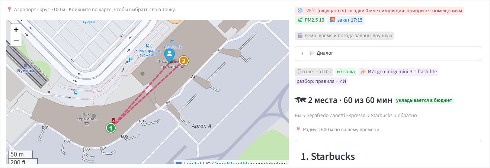
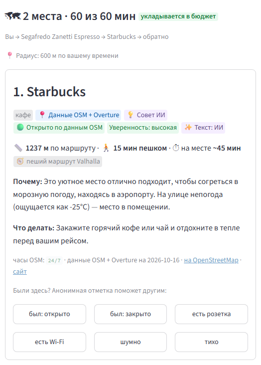
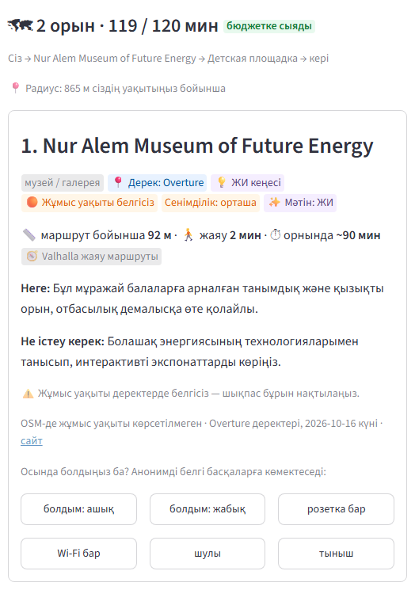
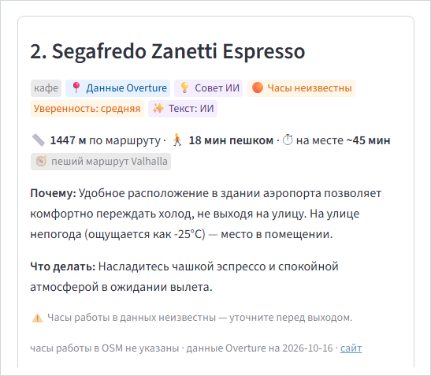
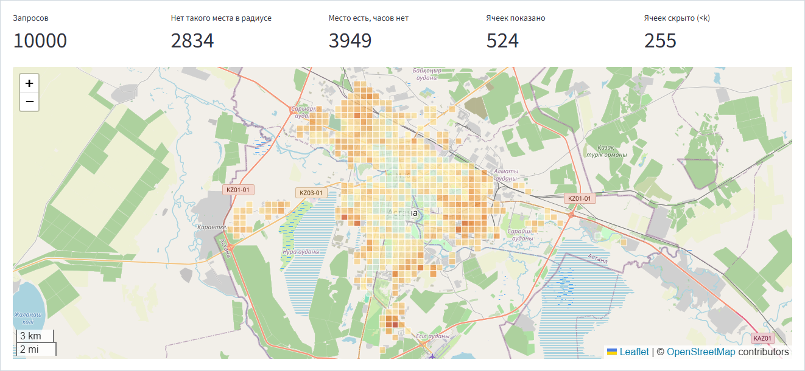
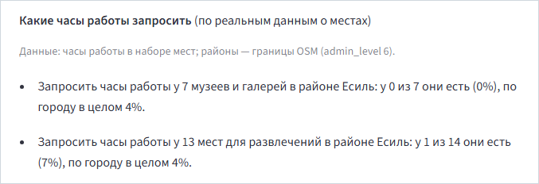

<!-- _class: lead -->
<!-- _paginate: false -->

*Сәлеметсіздер ме! Астанада орын емес, орындар туралы мәлімет жетіспейді.*

# Анық

## помощник для прогулок по Астане

**«Анық» по-казахски — «ясно».** В Астане не хватает не мест, а сведений о них: Анық даёт план на 1–3 места под ваше время и ясно пишет, что известно, а что нет. Тот же слой данных работает на город.

Ануар · AITU, 1 курс · Кейс НИЦ Smart City · Build with AI 2026

<!-- _footer: "Скриншот — настоящий ответ помощника: турист в аэропорту, −25 °C, до вылета 2 часа → маршрут из 2 мест ровно на 60 минут" -->

<!--
Время: 0:18.

Сказать по-казахски: «Сәлеметсіздер ме! Астанада орын емес, орындар туралы мәлімет жетіспейді.»
Сказать по-русски: «Это Анық. "Анық" по-казахски — "ясно": мы ясно говорим, что известно, а чего не знаем. В Астане не хватает не мест, а сведений о них. Пример: турист при минус двадцати пяти за два часа до вылета получает от помощника план на час — два места в аэропорту. У одного часы работы есть в данных, у другого нет, и это так и написано. А тот же слой данных работает на город».

Скриншот — настоящий ответ закреплённого демо на «Турист, 2 часа до вылета, на улице мороз» у «Аэропорт»: маршрут из двух мест на карте, «2 места · 60 из 60 мин», −25 °C, радиус 600 м. Карточки этого ответа — на слайдах 2 (Starbucks, «Открыто по данным OSM») и 6 (Segafredo Zanetti Espresso, «Часы неизвестны»). Кадр — запуск A (docs/video_script.md), снят 2026-10-17 скриптом app/scripts/record_demo.py (app/.local/video/full/full-02-cold-airport.png), обрезан до карты и шапки ответа.
Казахская фраза — та же, что строка-тезис первого экрана на «Қаз» (app/i18n.py, ключ `value`), чтобы дека и продукт говорили одно.
Казахский интерфейс и казахский ответ — на слайде 4.
Название «Анық» выбрал Ануар 2026-10-17 (docs/pitch/strategy.md §5). В интерфейсе то же: заголовок «🧭 Анық» и подпись «помощник для прогулок по Астане» (app/i18n.py, ключи `title` и `subtitle`), вкладка браузера «Анық — Астана» (app/ui.py). Те же слова — в титрах видео (docs/video_script.md) и в README.
В тексте слайда из чисел только «1–3 места» (ТЗ); −25 °C, «60 из 60 мин» и 600 м — на скриншоте, это вывод продукта (источники — в заметках к слайду 2). Казахские строки: проверка носителем, список в docs/pitch/strategy.md §6.
Сборка из корня репозитория (без `--allow-local-files` скриншоты из docs/presentation/img/ не попадут в PDF):
`npx @marp-team/marp-cli docs/presentation/deck.md --pdf --allow-local-files` и то же с `--pptx`.
-->

---

# −25 °C, 2 часа до вылета: нужен план, а не список мест

| Ответ списком | Честный план |
|---|---|
| Много мест, время человека не учтено | 1–3 места: час — на аэропорт, час — на прогулку |
| «Открыто» без источника | «Открыто по данным OSM» или «Часы неизвестны» |
| Парк, до которого идти по морозу | Сначала помещения, поиск в радиусе 600 м |
| «Интересное место» | Почему оно, сколько идти и пробыть, что делать |

*Вторая история: мама с ребёнком у EXPO. Площадка или музей — что рядом и что сейчас открыто?*

<!-- _footer: "Справа — настоящий ответ на этот запрос: строка маршрута и первая карточка; закреплённое демо 19.10 14:00, текст ИИ из записанного кэша · правила: docs/scenarios.md, «Допущения»" -->

<!--
Время: 0:40.

Сказать: «Турист в аэропорту Астаны. Ощущается минус двадцать пять, до вылета два часа. Обычный ответ — список мест: он не знает, сколько у человека времени, и пишет "открыто", не зная этого. Справа ответ помощника: он оставил час на аэропорт, а на второй час собрал маршрут из двух мест — ровно шестьдесят минут, это видно в строке сверху. В мороз — только помещения рядом. Первая карточка: у Starbucks часы есть в данных — "открыто по данным OSM". Почему именно это место и что там делать — тоже на карточке. Вторая история — мама с ребёнком у EXPO вечером: площадка или музей, что рядом и что открыто?»

Числа и источники:
- −25 °C — закреплённая погода демо для запроса со словом «мороз» (app/walks/demo_pin.py, `weather_for`) и ощущаемая температура холодных кейсов оценки (docs/scenarios.md, кейсы *-cold-*, напр. `msw-eve-cold-tourist`).
- 2 часа — сценарий 4 ТЗ («Турист, 2 часа до вылета»).
- Час на аэропорт — app/walks/intent.py (`reserve = 60`); docs/scenarios.md, «Допущения», «Рейс».
- 600 м — радиус поиска по прямой в мороз, ливень и смог: app/walks/radius.py `ADVERSE_WALK_CAP_M = 600`; мороз — ощущается −15 °C и ниже, app/walks/weather.py `COLD_APPARENT_C`. Путь по улицам бывает длиннее радиуса: на скриншоте до Starbucks 1237 м по маршруту Valhalla.
- 1–3 места — требование ТЗ.
- Скриншот справа: строка маршрута «2 места · 60 из 60 мин — укладывается в бюджет», «Вы → Segafredo Zanetti Espresso → Starbucks → обратно», «Радиус: 600 м по вашему времени» и первая карточка ответа (Starbucks: «Данные OSM + Overture», «Совет ИИ», «Открыто по данным OSM», «Уверенность: высокая», «Текст: ИИ»; 1237 м по маршруту, 15 мин пешком, ~45 мин на месте; часы OSM 24/7, данные на 2026-10-16; под карточкой — кнопки анонимных отметок). Запуск A (docs/video_script.md), запрос «Турист, 2 часа до вылета, на улице мороз» у «Аэропорт», закреплённое демо 19.10.2026 14:00, текст ИИ из записанного кэша. Кроп ScreenRec docs/presentation/img/rec-card-cold-ru.png из прогона app/scripts/record_demo.py 2026-10-17 05:40 (app/.local/video/full/card-02-cold-airport.png): отметки людей из сида, без кликов записи, без курсора, после дополнения записи ответов ИИ в коммите 3884cd4.
Левая колонка — обобщённый ответ списком, не скриншот конкретного продукта.
-->

---

<!-- _class: numbers -->

# В Астане не хватает не мест, а сведений о них

Я собрал базу мест из открытых источников и посчитал, что о них известно:

| 2 183 | 15.8% | 2.4% |
|:---:|:---:|:---:|
| места в базе: OpenStreetMap, Overture Maps, Wikipedia | с часами работы | с настоящим описанием: OSM-тег или Wikipedia |

Помощник не может обещать «открыто». Значит, он должен прямо говорить, что известно, а что нет.

<!-- _footer: "Источник: docs/figures.md §1, §4 (генерирует scripts/make_figures.py из data/*_stats.json)" -->

<!--
Время: 0:35.

Сказать: «Я собрал базу мест Астаны из открытых данных — две тысячи сто восемьдесят три места — и посчитал, что о них известно. Часы работы — у шестнадцати процентов. Настоящее описание — у двух с половиной процентов. Мест хватает, сведений нет. Отсюда главный принцип продукта: не знаем — так и пишем».

Числа и источники (docs/figures.md, сверено 2026-10-17, дерево e5b29df):
- 2 183 места в shipped-базе — §1, строка 15 (`after.total`); OSM-only baseline — 1 488 (строка 13), прирост 695 расшифрован в §8.
- 15.8% с часами работы — §4, строка 56 (все записи shipped); у записей из OSM — 23.1% (строка 57): записи только из Overture добавляют места, но почти не добавляют часов.
- 2.4% с настоящим описанием (OSM-тег или Wikipedia) — §4, строка 58; в baseline 0.1%.
- Если спросят про Overture: из 8 590 мест в границах Астаны порог уверенности 0.7 проходят 2 802 (§6, строки 91–92); у самых уверенных записей (0.9–1.0) пара в OSM есть в 35.2% (строка 117).
- В черновике было: 2 178 мест и 1.1% с описанием (до пересборки данных), 34.8% у корзины 0.9–1.0; 15.8% не изменилось.
Пересборка чисел: `uv run python scripts/make_figures.py`.
-->

---

# Ответ — план на ваше время и на вашем языке

- 1–3 места: сколько идти, сколько пробыть, **почему** и **что делать**
- маршрут сверху укладывается в бюджет: «2 орын · 119 / 120 мин»
- қазақша, русский, English: ответ на языке запроса; на казахском — даже без ИИ и без сети
- казахских кейсов в отложенном наборе пока 2 — мало: набор и эксперт — в просьбе о пилоте
- уточнения одной кнопкой («Поближе», «Ещё», «Без алкоголя») и анонимные отметки под карточкой

<!-- _footer: "Скриншот: «Баламен қайда баруға болады?» у EXPO, закреплённое демо, текст ИИ из записанного кэша · сценарии: docs/scenarios.md" -->

<!--
Время: 0:40.

Сказать: «Вот ответ на казахский запрос "Баламен қайда баруға болады?" — "куда можно пойти с ребёнком?" — у EXPO. Два места: музей и детская площадка. У каждого — сколько идти, сколько пробыть, почему именно оно и что там делать. Маршрут сверху укладывается в ваше время. Часов работы у обоих мест в данных нет — так и написано: уточните перед выходом. Без ИИ и без интернета ответ тоже будет по-казахски, шаблоном из тех же фактов. Честно: казахских кейсов в моей проверке пока два — это мало, поэтому в пилоте я прошу эксперта и набор запросов. Уточнить ответ можно одной кнопкой: поближе, ещё, без алкоголя».

Источники:
- Скриншот справа: строка маршрута «2 орын · 119 / 120 мин — бюджетке сыяды», «Сіз → Nur Alem Museum of Future Energy → Детская площадка → кері», радиус 865 м и первая карточка (Nur Alem: «Дерек: Overture», «ЖИ кеңесі», «Жұмыс уақыты белгісіз», «Сенімділік: орташа», «Мәтін: ЖИ»; 92 м, 2 мин, ~90 мин на месте; заметка «Жұмыс уақыты деректерде белгісіз — шықпас бұрын нақтылаңыз»; кнопки анонимных отметок). Запуск A (docs/video_script.md), «Баламен қайда баруға болады?» у «EXPO», закреплённое демо 19.10.2026 14:00, текст ИИ из записанного кэша. Кроп ScreenRec docs/presentation/img/rec-card-kk.png из прогона app/scripts/record_demo.py 2026-10-17 05:40 (app/.local/video/full/card-03-kazakh-expo.png). У второго места маршрута, детской площадки, часы тоже неизвестны (полный кадр app/.local/video/full/full-03-kazakh-expo.png).
- Без ИИ и без сети: `walks.cli --offline` с WALKS_DEMO_PIN=1 на этом запросе (дерево e5b29df) отвечает по-казахски: детская площадка, музей Nur Alem и KANGO, у всех трёх часы неизвестны.
- Казахский запрос — кейс h08 отложенного набора (app/eval/holdout_cases.json). Казахских запросов там 2 (h08, h19), оба без нарушений (app/eval/results/summary_poi.enriched_holdout_offline.md). Двух мало: тестовый набор на казахском — задача пилота.
- 1–3 места — ТЗ; кнопки уточнений — app/memory_ui.py; отметки — app/walks/feedback.py.
-->

---

# Куда идти, решает код; ИИ объясняет, а код проверяет его ответ

1. **Разбор запроса** — правила ru / kk / en; ИИ может только добавить категорию или флаг, и не ту, что запрос исключает
2. **Поиск без ИИ** — радиус из бюджета времени · часы на момент прихода · погода, воздух, закат, праздники · точки одной сети слиты
3. **ИИ пишет** «почему» и «что делать» только по фактам 1–3 кандидатов
4. **Код проверяет** — место только из кандидатов; расстояния, время и часы — из данных; «открыто сейчас» от модели вырезается
5. **Маршрут и бюджет** считает код

Цепочка ИИ: Gemini → Gemma → любой OpenAI-совместимый провайдер → шаблон из данных; на запрос — не больше 15 с, офлайн — ни одного сетевого запроса. Медиана ответа: без ИИ **6 мс**, с ИИ на бесплатном лимите **4.1 с**.

**Проверено отказом:** 16.10 у ключа кончилась квота — цепочка ИИ не ответила в 9 прогонах из 10, ответил шаблон из тех же данных, выдуманных мест 0.

<!-- _footer: "Подробно: docs/rag.md · app/README.md, «Конвейер» · задержка и отказ 16.10: app/eval/results/canonical.md, разделы «Метрики», «ИИ-режим», «Исторический стресс-прогон»" -->

<!--
Время: 0:40.

Сказать: «Как это устроено. Куда идти, решает код: радиус из вашего времени, часы на момент прихода, погода, закат, праздники. ИИ получает только факты кандидатов и пишет, почему и что делать. Код проверяет каждый ответ: чужое место выбрасывается, расстояния и часы — из данных. Если ИИ упал, отвечает следующий провайдер, потом шаблон. Это проверено по-настоящему: шестнадцатого октября у ключа кончилась квота — ответил шаблон, ни одного выдуманного места. Когда ИИ доступен, ответ с ним приходит за несколько секунд: в замере медиана около четырёх — вместе с ожиданием звеньев, упёршихся в бесплатный лимит. Без интернета тоже работает».

Числа и источники:
- 15 с на весь запрос — app/walks/llm.py `TOTAL_DEADLINE_S = 15.0` (разбор + генерация, все звенья; потом шаблон); описание — app/README.md, «Конвейер», п. 4.
- «Не ту, что запрос исключает» — app/walks/intent.py `llm_dropped` (коммит 846f5fa): категорию, которую добавил ИИ, а понятие запроса исключает («прогулка» — не торговый центр и не бар), код отбрасывает; тест на запросе tz1 — app/tests/test_lexicon.py `test_llm_cannot_add_a_mall_to_a_stroll`.
- Без ИИ: медиана 6 мс (p90 14 мс) — app/eval/results/canonical.md, строки 48–49, колонка poi.enriched / main; офлайн-путь с шаблонным текстом, строка так и подписана: «шаблон, без ИИ». В черновике было 5 мс и 12 мс.
- С ИИ: медиана 4.1 с — canonical.md, раздел «ИИ-режим (публичные модели Gemini, 10 кейсов, 17.10.2026)», строка 72: 4070 мс на 10 ответов ИИ, разбор + генерация, кэш выключен; «сюда входит ожидание отказавших звеньев». В этом прогоне часть звеньев отвечала 503 или таймаутом и пропускалась (поле generation_trace в runs_poi.enriched_llm-public.jsonl), поэтому медиана выше, чем в прогоне до исправления разбора: там было 2573 мс (canonical.md в коммите 3daf82f, строка 72; файлы summary_*_llm-public-before.md). Сам ответ модели на шаге текста — медиана 2289 мс (main) и 1698 мс (holdout): summary_poi.enriched_llm-public.md и summary_poi.enriched_holdout_llm-public.md, строка 31.
- Отказ 16.10 — canonical.md, раздел «Исторический стресс-прогон ИИ (16.10.2026)», строки 118–127: 5 сценариев ТЗ на двух базах, вся цепочка недоступна и ответил шаблон в 4 из 5 (poi) и 5 из 5 (poi.enriched), то есть в 9 прогонах из 10 (строка 124); hallucinated_poi 0 в обоих (строка 126). Это стресс-прогон в шторм квоты, не оценка качества ИИ; код и данные того дня не совпадают с текущими.
- 1–3 кандидата — ТЗ, app/walks/generate.py.
- Польза ИИ при разборе запроса поверх словаря, если спросят: 69 запросов всех трёх наборов, только публичные звенья Google, без кэша; у словаря пробел в 4 запросах, ИИ закрыл 1, в 2 добавил новый пробел (app/eval/results/intent_compare.md, git 3c89ac3+uncommitted). Поэтому категории решает словарь. Главная роль ИИ — рассказ «почему» и «что делать» на языке человека и разбор коротких уточнений в диалоге (app/walks/followup.py).
Про AlemLLM, если спросят: профиль готов, ключа нет, в замерах не участвовала (docs/pitch/strategy.md §8).
-->

---

<!-- _class: tight -->

# Не знаем — так и пишем; лишнего о человеке не храним

**Честность**
- «Открыто» — только по часам из данных; нет часов → «Часы неизвестны»; праздник → «неизвестно»
- На карточке источник и дата снимка; совет ИИ и отметки людей помечены отдельно
- Панель «Какие данные использованы»: точный запрос к ИИ

**Приватность**
- Координаты округляются до ~100 м прямо на входе
- В журнал — час, ячейка 500 м, категории, без текста запроса
- Городу — только группы от 5 запросов; профиль выключен по умолчанию

<!-- _footer: "Справа — вторая карточка ответа со слайдов 1–2 · подробно: docs/ethics.md" -->

<!--
Время: 0:35.

Сказать: «Два правила. Первое: не знаем — так и пишем. Справа настоящая карточка: часов работы в данных нет — бейдж "Часы неизвестны" и просьба уточнить перед выходом; источник — Overture, дата снимка; "Совет ИИ" помечен отдельно. "Открыто" мы пишем только по часам из данных, в праздник — "неизвестно". Под ответом панель "Какие данные использованы" показывает точный запрос к ИИ. Второе: не храним. Координаты округляются до ста метров на входе, текст запроса не пишется никуда. Городу видны только группы от пяти запросов».

Числа и источники (константы кода):
- ~100 м — app/walks/pipeline.py `COORD_DECIMALS = 3`.
- 500 м — app/walks/reqlog.py `CELL_M = 500`.
- От 5 запросов — app/walks/demand.py `K_DEFAULT = 5`; для реального журнала k в интерфейсе не опускается ниже 5 (app/city_ui.py).
- Отметки людей: окно 30 дней, вес падает вдвое за 14 дней, противоречия снижают уверенность — app/walks/feedback.py `WINDOW_DAYS = 30`, `HALF_LIFE_DAYS = 14.0`. На слайд не вынесено, чтобы не перегружать числами.
- Скриншот справа: вторая карточка ответа со слайдов 1–2 — Segafredo Zanetti Espresso: «Данные Overture», «Совет ИИ», «Часы неизвестны», «Уверенность: средняя», «Текст: ИИ», предупреждение «Часы работы в данных неизвестны — уточните перед выходом», данные Overture на 2026-10-16. Источник кадра — app/.local/video/full/full-02-cold-airport.png, обрезан.
-->

---

<!-- _class: numbers -->

# На отложенном наборе — 55% кейсов без единого нарушения: это честная цифра

| 55% | 100% | 100% |
|:---:|:---:|:---:|
| **Отложенный набор** (holdout): 11 из 20 кейсов. Писался отдельно, ранжирование на нём не подгоняли | **Подходящего нет** (abstain): в 8 из 8 — честный отказ или помеченный компромисс | **Основной набор** (main): 41 из 41, но на нём правила подгоняли — это не доказательство |

- Обогащение данных подняло отложенный набор с 40% (только OSM) до 55% — без всякой модели
- ИИ-режим, отдельный замер на 10 кейсах (публичный Gemini): текст ИИ в 10 из 10; «открыто» без данных и выдуманных мест — 0; не та категория — в 1 из 10, до исправления разбора было 2 (подробно — слайд 14)
- Порог «с ребёнком ≤ 15 мин пешком» — допущение: введён, когда на основном наборе не прошли два детских кейса, и выбран в пределах лимитов из кейсов

<!-- _footer: "Источник: app/eval/results/canonical.md — офлайн-прогоны и раздел «ИИ-режим», git 846f5fa · все числа — запасные слайды 13–14" -->

<!--
Время: 0:40.

Сказать: «Как я мерил. Три набора кейсов. На отложенном — его писали отдельно, ранжирование на нём не подгоняли — без единого нарушения пятьдесят пять процентов кейсов, одиннадцать из двадцати. Это честная цифра. Обогащение данных подняло её с сорока процентов, без всякой модели. В ситуациях, где подходящего места нет вообще, система в восьми случаях из восьми честно говорит об этом или помечает компромисс. Основной набор я подгонял, поэтому его сто процентов ничего не доказывают. Порог для прогулки с ребёнком — моё допущение: я ввёл его, когда два детских кейса не прошли, и выбрал в пределах, записанных в кейсах, — здесь наборы не полностью независимы. ИИ-режим я замерил отдельно, на десяти кейсах — сценарии ТЗ и трудные запросы: текст ИИ написал во всех десяти, ни разу не написал "открыто" без данных и не выдумал места. В первом прогоне в двух кейсах ИИ на шаге разбора добавил не ту категорию; я поставил фильтр и проверил его тестом. Во втором прогоне нарушение одно из десяти, и оно уже в правиле ранжирования для мороза, а не в разборе».

Числа и источники (app/eval/results/canonical.md в дереве 3884cd4; офлайн-прогоны 2026-10-17 05:29, git `846f5fa+uncommitted`, строка 3):
- 41 / 20 / 8 кейсов — строка 28; определения наборов — строка 5 («main — на нём подгонялись правила ранжирования»).
- Кейсов без единого нарушения: 100% main (41 из 41), 55% holdout (11 из 20) — строка 31, колонки poi.enriched; 40% — holdout на poi.json (только OSM), та же строка.
- Честный отказ или помеченный компромисс (honest_abstain_rate): 100% (8 из 8) — строка 45; по кейсам — строки 57–64.
- Офлайн выдуманных мест 0 — строка 29; текст там шаблонный, поэтому ноль по построению.
- ИИ-режим после исправления разбора — раздел «ИИ-режим (публичные модели Gemini, 10 кейсов, 17.10.2026)», строки 66–95, прогон на git 846f5fa. Кейсы: 5 сценариев ТЗ и 5 кейсов holdout (h04, h08, h13, h18, h20), выбранных вручную до прогона и нарочно трудных для словаря; по ним нельзя судить о доле ИИ на любых запросах (строка 68). Текст ИИ 10 из 10, шаблон 0 (строка 70); разбор читал ИИ в 9 из 10 (строка 71); «открыто» без данных 0, метки честности 10 из 10, категория вне допустимых — 1 кейс (строка 80); по кейсам — строки 84–93. Выдуманных мест 0 и ни одного ответа, отброшенного проверкой poi_id: summary_poi.enriched_llm-public.md и summary_poi.enriched_holdout_llm-public.md, строки 10 и 28. Текст писали gemini-3.5-flash-lite (7) и gemini-3.1-flash-lite (3), строки 76–77: часть звеньев отвечала 503 или таймаутом.
- До и после исправления — подраздел «До и после исправления разбора намерения», строки 97–116: нарушение категории 2 из 10 → 1 из 10 (строка 101), кейсов без единого нарушения 8 → 9 из 10 (строка 102), текст ИИ 10 → 10 (строка 103). «До» — прогон 3daf82f, метка llm-public-before, файлы сохранены. Исправление — app/walks/intent.py `llm_dropped` (коммит 846f5fa): категорию, которую добавил ИИ, а понятие запроса исключает, код отбрасывает.
- Оговорки, проговаривать честно. tz1 («Рядом с Mega Silk Way, прогулка 30–60 мин»): до исправления ИИ добавил «торговый центр» → Mega Silk Way; после — NU Park (строка 107). Но во втором прогоне ИИ-звено разбора для tz1 не ответило (таймаут, строка 84: «правила (ИИ не ответил)»), так что этот прогон заслугу фильтра не доказывает; фильтр на запросе tz1 проверен тестом app/tests/test_lexicon.py `test_llm_cannot_add_a_mall_to_a_stroll`. h20 («куда сходить на Новый год, что открыто», мороз −15 °C) нарушен и до, и после (строка 116): запрос ничего не исключает, фильтру нечего отбрасывать, а достопримечательность в мороз — вопрос правила ранжирования, не разбора. «Исправили ИИ» не говорить.
- Порог «с ребёнком не дальше 15 мин пешком в одну сторону» — app/walks/radius.py `KIDS_WALK_MAX_MIN = 15`. Его ввели в коммите caf7692, после того как на main два детских кейса (lrt-eve-normal-kids, left-eve-normal-kids) не прошли по пешему лимиту: прогон до порога (canonical.md в коммите caf7692) давал на main 95.1%. 15 мин — продуктовое допущение, выбранное в пределах лимитов, записанных в кейсах (main: 12 или 15 мин, holdout: 15 или 20); данных горожан, которые задавали бы порог, нет (docs/scenarios.md, «Допущения», «С ребёнком»). Поэтому в этой части main и holdout не полностью независимы. Независимая проверка — набор holdout2: 24 кейса, написаны другой моделью без доступа к коду (app/eval/holdout2_cases.json, коммит 1d153eb); на момент сверки его чисел в canonical.md ещё нет. holdout был 55% и до порога, и в черновике (git f09c0f7), но это не абляция: между прогонами менялся и другой код.
- Изменения против черновика деки: abstain 87.5% → 100% (кейс a08 теперь проходит, строка 64); main 100% — теперь после порога для детей; holdout 55% и 40% не изменились; coverage holdout 80% → 85% (на слайд не вынесено); ИИ-режим: в черновике — обещание «числа после прогона на Gemini с кэшем», в версии e5b29df — «не измерен», в версии 3daf82f — 2 нарушения из 10, теперь — 1 из 10 после исправления разбора; git 351a5e1 → 846f5fa+uncommitted.
- Если спросят, почему ошибается holdout офлайн: из 9 кейсов с нарушениями в 6 категория не та, что ожидал кейс, в 2 дорога длиннее лимита, в 1 маршрут дольше бюджета (app/eval/results/summary_poi.enriched_holdout_offline.md, «Нарушения»).
- Все числа: офлайн — запасной слайд 13, ИИ-режим — запасной слайд 14.
-->

---

<!-- _class: city -->

# Тот же слой данных — городу: механизм готов, спрос пока смоделирован

> 🧪 Спрос в демо смоделирован: 10 000 синтетических запросов через настоящий конвейер. Это показ механизма, а не наблюдение о жителях.

- Слева — смоделированный спрос по ячейкам 500 м: анонимно, без текста и координат; группы меньше 5 запросов скрыты; выгрузка CSV и GeoJSON
- Справа — настоящее уже сейчас: задачи городу по реальным данным о местах

 

<!-- _footer: "Скриншоты вкладки «Для города»: карта — смоделированный спрос (data/demand_sim.meta.json), задачи — реальные данные о местах · app/walks/city_actions.py" -->

<!--
Время: 0:40.

Сказать: «Тот же слой данных работает на город. Каждый запрос оставляет анонимную строку: час, ячейка, категория. Слева карта: город видит, где людям нечего предложить рядом и где в данных дыры. Группы меньше пяти запросов скрыты. Важно: спрос здесь смоделирован — это механизм, а не жители, и в продукте это написано на самой вкладке. А справа — настоящее: качество данных по реальной базе. В районе Есиль ни у одного из семи музеев и галерей нет часов работы в данных. Это задача городу: запросить часы».

Числа и источники:
- 10 000 синтетических запросов, seed 20261019 — data/demand_sim.meta.json: `n`, `seed`, `simulated: true`. При k = 5 скрыто 255 из 779 ячеек — `stats.cells_suppressed`, `stats.cells`. Это числа симуляции, не наблюдения. Симуляция посчитана на базе 2 178 мест (`poi_dataset_places`), до пересборки данных до 2 183. В черновике числа те же.
- Скриншот слева — счётчики и карта ячеек вкладки «Для города»: 10000 запросов, 2834 «нет такого места в радиусе», 3949 «место есть, часов нет», 524 ячейки показано, 255 скрыто; это `stats.requests`, `no_requested_category_nearby`, `hours_unknown_nearby`, `cells_shown`, `cells_suppressed` из data/demand_sim.meta.json. Кроп docs/presentation/img/city_map.png вырезан из кадра ScreenRec (прогон app/scripts/record_demo.py 2026-10-17 05:41, app/.local/video/full/city.png; карта подогнана под Астану); над картой в продукте стоит та же пометка «Это смоделированный спрос, не наблюдение о городе».
- 500 м и «от 5 запросов» — константы кода, см. слайд 6.
- Скриншот справа: «Запросить часы работы у 7 музеев и галерей в районе Есиль: у 0 из 7 они есть (0%), по городу в целом 4%» — вывод `hours_actions` (app/walks/city_actions.py) по data/poi.enriched.json и границам районов OSM (admin_level 6). Вкладка «Для города» → «Что с этим делать городу» → «Какие часы работы запросить», правая колонка; кадр 2026-10-17 05:41 (app/.local/video/full/full-05-city.png) совпадает с кропом попиксельно. В docs/figures.md и canonical.md этих чисел нет: это вывод продукта на данных дерева 3884cd4.
- Левая колонка того же блока «Где в данных нет места нужного вида» посчитана по симуляции и так и подписана в продукте; на слайд не взята.
-->

---

# Мы не берём данные, которые нельзя хранить, проверять и честно помечать

- **2ГИС**: условия API запрещают кэшировать и менять данные (п. 4.7), требуют показывать их без изъятий и дополнений (п. 4.8), передавать запросы без фильтрации (п. 4.3) и отдавать правообладателю IP, ID сессии и cookie пользователя (п. 4.4)
- **Яндекс и Google Places**: собственную базу из их выдачи держать нельзя
- **События**: открытой ленты нет, Ticketon — по договору. Афиши без разрешения не парсим и «сейчас идёт выставка» не пишем
- **Транспорт**: публичного GTFS Астаны нет, CTS — по договору. В плане — открытый GTFS-датасет исследователей AITU
- **Векторный поиск**: настоящее описание есть у 2.4% мест, искать по смыслу почти не по чему

<!-- _footer: "law.2gis.kz/api-rules/ru (проверено 2026-10-17) · docs/presentation/data-sources.md · AITU GTFS: doi.org/10.5281/zenodo.15769359 · docs/figures.md §4" -->

<!--
Время: 0:30.

Сказать: «Чего я не делал сознательно. 2ГИС: по их условиям нельзя хранить данные, нельзя ничего дописывать, а IP и cookie пользователя надо отдавать им. Это против и базы, и приватности. События: открытой ленты нет, поэтому про выставки система не пишет. Транспорт: открытого GTFS города нет. Для плана я опираюсь на открытый датасет исследователей AITU».

Источники:
- 2ГИС: «Соглашение API Справочники 2ГИС», пп. 4.3, 4.4, 4.7, 4.8 (и п. 3.3: нельзя вместе с картой третьих лиц) — law.2gis.kz/api-rules/ru, прочитано 2026-10-17.
- Яндекс п. 5.1.5, Google Places (хранение только place_id и координат ≤ 30 дней) — docs/presentation/data-sources.md, раздел 3 и строка Google в разделе 2.
- Датасет AITU: «From Raw GPS to GTFS: A Real-World Open Dataset for Bus Travel Time Prediction», MDPI Data 10(8):119, 2025, doi 10.3390/data10080119; Zenodo 10.5281/zenodo.15769359, CC BY 4.0; 3 маршрута (10, 12, 46), июль–сентябрь 2024. В пайплайн пока не входит — только основа плана.
- 2.4% — docs/figures.md §4, строка 58 (в черновике было 1.1%, до пересборки данных).
-->

---

<!-- _class: tight -->

# Польза — жителю, городу и месту; у каждого риска уже есть механизм

**Кому польза**
- Жителю и туристу — бесплатный помощник, который не выдумывает «открыто»
- Городу (акимат, Visit Astana, НИЦ) — карта спроса и пробелов в данных, выгрузки CSV и GeoJSON
- Месту — путь в рекомендации: часы работы и описание в открытых данных

**Чем отличаемся**
- Справочник отвечает «что есть рядом», бот досуга — «какие события»; мы — «что я успею за своё время и что о месте известно на самом деле»

**Риски и что уже сделано**
- Данные устаревают → дата снимка, отметки людей с затуханием, «неизвестно» вместо догадки
- ИИ недоступен или дорог → цепочка провайдеров, шаблон, офлайн; не больше двух коротких вызовов ИИ на запрос, с кэшем
- Накрутка отметок → у отметок слабый вес; в пилоте нужны лимиты и модерация

<!-- _footer: "Риски и пробелы: docs/ethics.md §11 · отличия: docs/qa.md, вопрос 3 · ограничения: docs/scenarios.md, app/README.md «Ограничения»" -->

<!--
Время: 0:30.

Сказать: «Кому это нужно. Жителю и туристу — бесплатно. Городу — карта: где людям нечего предложить и где дыры в данных. Месту — путь в рекомендации через открытые данные. Справочник отвечает, что есть рядом, бот досуга — какие события. Мы отвечаем, что вы успеете за своё время и что о месте известно на самом деле. Риски я знаю: данные стареют, ИИ может упасть, отметки можно накрутить. Против каждого уже есть механизм, остальное — задача пилота».

Чисел на слайде нет. Приватность — на слайде 6. Конкуренты — обобщённо, без названий продуктов на слайде (docs/pitch/strategy.md §4, рычаг 2); если спросят — docs/qa.md, вопрос 3 (Seruen AI — бот досуга по афишам, digitalbusiness.kz, 28.10.2024).
-->

---

# Предлагаю НИЦ Smart City пилот: 4 недели, один район или кампус

**Что получит город**
- карту спроса по настоящему анонимному журналу вместо симуляции
- список мест, у которых нужно запросить часы работы, и правки в OSM
- тестовый набор запросов на казахском и отчёт по метрикам на реальных запросах

**Просим у НИЦ четыре вещи**
1. Площадку: район или кампус
2. Канал к данным: CTS, акимат, data.egov.kz
3. Эксперта по казахскому NLP
4. Совместный разбор агрегатов

<!-- _footer: "Готово сейчас: помощник қаз / рус / eng, офлайн-режим, слой «город», оценка main / holdout / abstain · план: docs/presentation/data-sources.md · docs/qa.md, вопрос 15" -->

<!--
Время: 0:40.

Сказать: «Механизм города уже работает на смоделированном спросе. Пилот сделает спрос настоящим. Предлагаю четыре недели в одном районе или на кампусе. Город получает карту спроса по настоящему журналу, список мест, у которых нужно запросить часы, и отчёт по метрикам. Казахский проверяет эксперт, не я. Прошу у НИЦ четыре вещи: площадку, канал к данным, эксперта по казахскому и совместный разбор результатов».

4 недели — значение по умолчанию, окончательно решает Ануар (docs/pitch/strategy.md §4, рычаг 7: четыре недельных цикла будни/выходные и первые морозы конца октября, когда проверяется погодное правило).
Транспорт, если спросят: «пешком + автобус» на открытом GTFS-датасете исследователей AITU (MDPI Data 10(8):119, 2025), с CTS — живые данные; в пайплайн пока не входит. События — Ticketon по договору.
AlemLLM — только как кандидат для сравнения на казахских запросах: ключа нет, в замерах не участвовала.
-->

---

<!-- _class: lead -->
<!-- _paginate: false -->

# Рақмет! Пилоттық жобаны бірге бастайық.

Спасибо! Давайте вместе запустим пилот.

**Анық — помощник для прогулок по Астане**
Ссылки на репозиторий и видео — в форме сдачи
Документы в репозитории: docs/scenarios.md, docs/rag.md, docs/ethics.md

Ануар · AITU, 1 курс · Telegram @tempoloss

<!-- _footer: "Данные: © OpenStreetMap contributors (ODbL) · Overture Maps (CDLA-Permissive-2.0) · Wikidata (CC0) · Wikipedia (CC BY-SA 4.0) · Open-Meteo (CC BY 4.0) · маршруты: Valhalla / FOSSGIS" -->

<!--
Время: 0:10.

Сказать по-казахски: «Рақмет! Пилоттық жобаны бірге бастайық.»
По-русски: «Спасибо. Давайте вместе запустим пилот».
Ссылки на репозиторий и видео в деке не печатаются: они в форме сдачи. Контакт — Telegram @tempoloss. Название на слайде — то же, что в интерфейсе и в README.
Дальше — вопросы, ответы в docs/qa.md (про название — вопрос 16).
-->

---

<!-- _class: backup -->

# Запасной слайд: офлайн-оценка — все числа из одного файла, без округления

| метрика (офлайн, текст шаблонный) | main · OSM | main · обогащ. | holdout · OSM | holdout · обогащ. | abstain · OSM | abstain · обогащ. |
|---|---:|---:|---:|---:|---:|---:|
| кейсов | 41 | 41 | 20 | 20 | 8 | 8 |
| hallucinated_poi (должно быть 0) | 0 | 0 | 0 | 0 | 0 | 0 |
| constraint_ok_rate (рекомендации без нарушений) | 99.2% | 100.0% | 71.4% | 82.5% | 100.0% | 100.0% |
| кейсов без единого нарушения | 97.6% | 100.0% | 40.0% | 55.0% | н/п | н/п |
| honest_unknown_rate (кейсы) | 100.0% | 100.0% | 100.0% | 100.0% | 100.0% | 100.0% |
| honest_unknown_rate, кейсы «ночь/праздник» | 100.0% | 100.0% | 100.0% | 100.0% | 100.0% | 100.0% |
| coverage (≥1 рекомендация проходит все ограничения) | 100.0% | 100.0% | 80.0% | 85.0% | н/п | н/п |
| diversity (нет дублей сети среди рекомендаций) | 100.0% | 100.0% | 100.0% | 100.0% | 100.0% | 100.0% |
| top-1 без нарушений ограничений | 100.0% | 100.0% | 70.0% | 80.0% | 100.0% | 100.0% |
| top-1 с подтверждённым «открыто» | 68.3% | 56.1% | 45.0% | 40.0% | 50.0% | 50.0% |
| доля рекомендаций с неизвестными часами | 45.5% | 53.7% | 66.1% | 77.2% | 60.0% | 64.7% |
| доля рекомендаций не из OSM-записей | 0.0% | 56.1% | 0.0% | 42.1% | 0.0% | 58.8% |
| средняя дорога до рекомендации, мин | 5.0 | 4.9 | 7.2 | 6.7 | 9.6 | 9.1 |
| padding: рекомендации, добранные расширением радиуса или другой категорией | 9.1% | 4.1% | 35.7% | 21.1% | 53.3% | 47.1% |
| … за счёт расширения радиуса (radius_factor > 1) | 0.0% | 0.0% | 0.0% | 0.0% | 6.7% | 11.8% |
| … за счёт другой категории (back-fill) | 9.1% | 4.1% | 35.7% | 21.1% | 46.7% | 35.3% |
| padding: кейсы хотя бы с одной такой рекомендацией | 17.1% | 7.3% | 55.0% | 30.0% | 66.7% | 50.0% |
| honest_abstain_rate (нет рекомендаций или каждое несовпадение помечено) | н/п | н/п | н/п | н/п | 100.0% | 100.0% |
| latency пайплайна, медиана / p90 (шаблон, без ИИ), мс | 4 / 7 | 6 / 14 | 4 / 16 | 6 / 20 | 3 / 19 | 4 / 23 |

ИИ-строки (недоступность цепочки, откат после проверки poi_id, latency ответа ИИ) — н/п во всех колонках: офлайн-прогон без модели. ИИ-режим замерен отдельно, на 10 кейсах — слайд 14. main подгоняли, holdout писался отдельно, abstain — заведомо скудные ситуации.

<!-- _footer: "app/eval/results/canonical.md, строки 28–51 · прогоны offline 2026-10-17 05:29, git 846f5fa+uncommitted (дерево 3884cd4) · пересборка в app/: uv run poe eval" -->

<!--
Запасной слайд, в 6:38 выступления не входит. Показывать, если спросят про метрики или определения.
Определения — app/eval/results/canonical.md, строки 5–11: main — набор, на котором подгонялись правила ранжирования; holdout — написан отдельно; abstain — заведомо скудные ситуации; padding — рекомендации, добранные расширением радиуса или другой категорией, с меткой на карточке; н/п — метрика не определена для набора или для офлайн-прогона без модели.
«OSM» — замороженная база data/poi.json (1 488 мест), «обогащ.» — shipped data/poi.enriched.json (2 183 места, docs/figures.md §1).
Числа перенесены из canonical.md без округления; строки latency медиана и p90 объединены в одну. Против версии 3daf82f изменилась только latency (перегенерация 05:29): main · обогащ. 6 / 13 → 6 / 14, holdout · OSM 4 / 17 → 4 / 16, holdout · обогащ. 8 / 18 → 6 / 20, abstain · OSM 2 / 19 → 3 / 19, abstain · обогащ. 4 / 22 → 4 / 23 мс: время шаблонного пути от прогона к прогону гуляет на 1–2 мс.
-->

---

<!-- _class: backup -->

# Запасной слайд: ИИ-режим на 10 кейсах — до и после исправления разбора

| набор | кейс | запрос | разбор | рек. | «открыто» без данных | категория места: до → после | метки честности | мс |
|---|---|---|---|---:|---|---|---|---:|
| main | tz1 | Рядом с Mega Silk Way, прогулка 30–60 мин | словарь (ИИ не ответил) | 1 | нет | **нарушена** → ок: Mega Silk Way → NU Park | ок | 13533 |
| main | tz2 | Тихое место с кофе и розеткой | ИИ | 2 | нет | ок → ок | ок | 9743 |
| main | tz3 | С ребёнком: площадка или интерактивный музей | ИИ | 2 | нет | ок → ок | ок | 6898 |
| main | tz4 | Турист, 2 часа до вылета | ИИ | 2 | нет | ок → ок | ок | 2597 |
| main | tz5 | Необычная ночная активность | ИИ | 2 | нет | ок → ок | ок | 2807 |
| holdout | h04 | гулять с коляской и без алкоголя | ИИ | 2 | нет | ок → ок | ок | 7880 |
| holdout | h08 | баламен қайда баруға болады | ИИ | 2 | нет | ок → ок | ок | 3227 |
| holdout | h13 | куда пойти ночью, я только приехал и голодный | ИИ | 1 | нет | ок → ок | ок | 2804 |
| holdout | h18 | quiet place to read, open late | ИИ | 1 | нет | ок → ок | ок | 2790 |
| holdout | h20 | куда сходить на Новый год, что открыто | ИИ | 1 | нет | **нарушена** → **нарушена**: Байтерек в мороз | ок | 4913 |

После исправления (git 846f5fa): текст ИИ — 10 из 10, шаблон — 0; выдуманных мест и ответов, отброшенных проверкой poi_id, — 0; нарушение категории — 1 из 10 вместо 2. Медиана — 4070 мс вместе с ожиданием звеньев, упёршихся в бесплатный лимит (до исправления — 2573 мс). Оговорки: в tz1 ИИ-звено разбора не ответило и запрос разобрал словарь, поэтому заслугу фильтра этот прогон не доказывает — её проверяет тест; в h20 запрос ничего не исключает, а достопримечательность в мороз — вопрос правила ранжирования, не разбора. Кейсы holdout выбраны вручную так, чтобы набор был трудным для словаря: на любые запросы не обобщать.

<!-- _footer: "app/eval/results/canonical.md, раздел «ИИ-режим», строки 66–116 · summary_poi.enriched_llm-public.md, summary_poi.enriched_holdout_llm-public.md · прогоны 17.10 05:27–05:28" -->

<!--
Запасной слайд, в 6:38 выступления не входит. Показывать, если спросят, как ИИ работает на самом деле.
Источник: app/eval/results/canonical.md, раздел «ИИ-режим (публичные модели Gemini, 10 кейсов, 17.10.2026)»: условия прогона и выбор кейсов — строка 68, итоги — строки 70–72, звенья текста — строки 76–77, проверки — строка 80, таблица «после» — строки 84–93; подраздел «До и после исправления разбора намерения» — строки 97–116 (итоги 101–103, top-1 до и после — 107–116). Выдуманных мест 0 и отброшенных ответов 0 — summary_poi.enriched_llm-public.md и summary_poi.enriched_holdout_llm-public.md, строки 10 и 28. Медиана до исправления 2573 мс — canonical.md в коммите 3daf82f, строка 72.
Колонка «разбор»: кто разобрал запрос во втором прогоне (строки 84–93); «ИИ» — словарь плюс ИИ. Колонка «категория места: до → после» — вердикт по категории в прогонах до (llm-public-before) и после; названия мест — top-1 из строк 107 и 116. Запросы — app/eval/cases.json (tz1–tz5) и app/eval/holdout_cases.json.
tz1: до исправления ИИ добавил к словарным парку, достопримечательности и смотровой «торговый центр», ядро выбрало Mega Silk Way. Фильтр (app/walks/intent.py `llm_dropped`, коммит 846f5fa) не даёт ИИ добавить к «прогулке» торговый центр, бар, фастфуд и «прочее»; на запросе tz1 его проверяет тест app/tests/test_lexicon.py `test_llm_cannot_add_a_mall_to_a_stroll`. h20: ИИ дал развлечения и достопримечательность, ядро выбрало Байтерек; кейс 1 января в мороз допускает только крытые места (app/eval/holdout_cases.json).
Говорить «одна ошибка из десяти, и она в правиле ранжирования», а не «ИИ исправили».
-->
